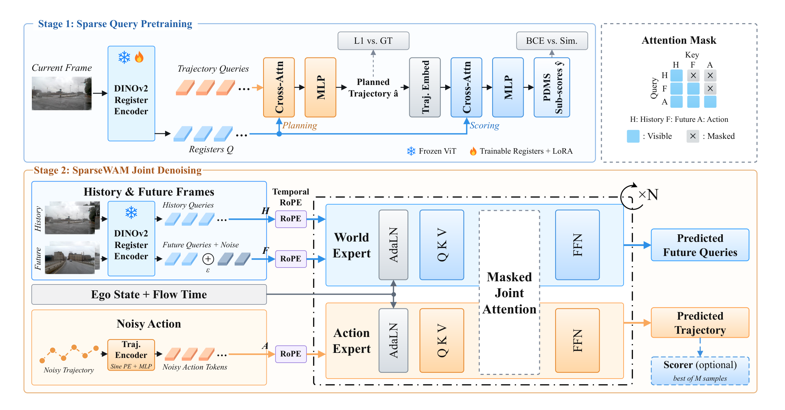
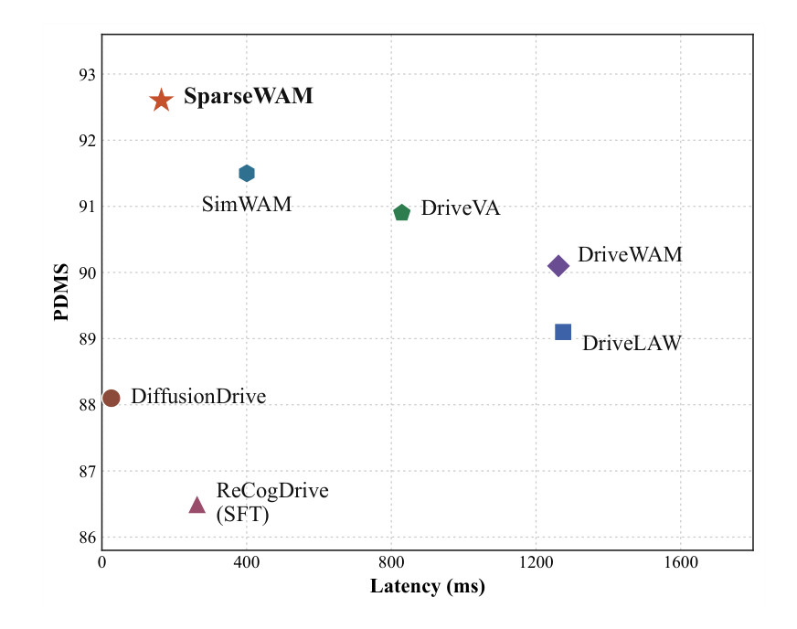
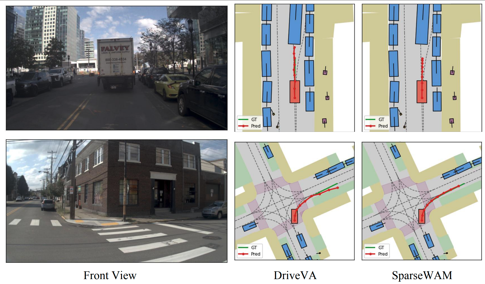

# SparseWAM: Driving World-Action Models are Worth 16 Register Tokens

<p align="center">
  <a href="https://github.com/AutoLab-SAI-SJTU/SparseWAM"></a>
  <a href="LICENSE"></a>
</p>

<p align="center">
  Yixiang Yang<sup>1,*</sup>,
  Lizhong Zhang<sup>1</sup>,
  Xingyu Zhang<sup>2</sup>,
  Zhiwen Chen<sup>1,3</sup>,
  Jie Ling<sup>2</sup>,
  Qiankun Yu<sup>2</sup>,
  Xingliang Liu<sup>2</sup>,
  Yang Lei<sup>2</sup>,
  Zhipeng Zhang<sup>1,&dagger;</sup>
</p>

<p align="center">
  <sup>1</sup>AutoLab, School of Artificial Intelligence, Shanghai Jiao Tong University<br>
  <sup>2</sup>Guangzhou Zaofu Intelligent Technology Co., Ltd.<br>
  <sup>3</sup>The Hong Kong University of Science and Technology (Guangzhou)
</p>

<p align="center">
  <sup>*</sup>Work done at Guangzhou Zaofu Intelligent Technology Co., Ltd. &nbsp;&nbsp; <sup>&dagger;</sup>Corresponding authors.
</p>

This repository provides the official implementation of **SparseWAM** for the paper **Driving World-Action Models are Worth 16 Register Tokens**, including front-camera register encoder pretraining and SparseWAM training and evaluation on NAVSIM.

## News

- **`October 9th, 2026`:** NavSim v1 training and evaluation code released.

## Table of Contents

- [News](#news)
- [Table of Contents](#table-of-contents)
- [Introduction](#introduction)
- [Installation](#installation)
- [Data Preparation](#data-preparation)
- [Model Preparation](#model-preparation)
- [Training](#training)
- [NavSim v1 Evaluation](#navsim-v1-evaluation)
- [Acknowledgments](#acknowledgments)
- [Citation](#citation)

## Introduction

SparseWAM is a world-action model that forecasts future scenes and ego trajectories in a sparse register space of only 16 tokens per frame. Unlike video world-action models that generate dense future videos at inference, or efficient variants that drop the world branch at deployment, SparseWAM focuses on predicting planning-relevant scene evolution, and keeps explicit imagine-then-act reasoning while remaining lightweight.

The 16 registers are compressed from a frozen DINOv2 encoder and shaped by joint planning-and-scoring pretraining, so the prediction space stays aligned with driving decisions rather than background appearance. A Mixture-of-Transformers then jointly denoises future registers and the ego trajectory under a causal attention mask: future registers do not attend to action tokens, while action tokens attend to the denoised future.

<p align="center">
  
</p>

With one front camera, SparseWAM reports **92.6 PDMS** on NAVSIM v1 at **164 ms**, **90.1 EPDMS** on NAVSIM v2, and **39.6 EPDMS** on NavHard. The 92.6 PDMS entry uses 64 sampled trajectories. A single sample scores 89.1 PDMS in 122 ms.

<p align="center">
  
</p>

### NAVSIM v1

With one front camera, SparseWAM reaches 92.6 PDMS, 1.7 above DriveVA, and raises ego progress by 3.1 while also improving no-collision.

| Method | Reference | Sensors | NC ↑ | DAC ↑ | EP ↑ | TTC ↑ | C ↑ | PDMS ↑ |
|---|---|---|---:|---:|---:|---:|---:|---:|
| Human Agent | – | – | 100.0 | 100.0 | 87.5 | 100.0 | 99.9 | 94.8 |
| *Traditional E2E planners* | | | | | | | | |
| UniAD | CVPR 2023 | 6×C | 97.8 | 91.9 | 78.8 | 92.9 | 100.0 | 83.4 |
| TransFuser | TPAMI 2022 | 3×C+L | 97.7 | 92.8 | 79.2 | 92.8 | 100.0 | 84.0 |
| DiffusionDrive | CVPR 2025 | 3×C+L | 98.2 | 96.2 | 82.2 | 94.7 | 100.0 | 88.1 |
| WoTE | ICCV 2025 | 3×C+L | 98.5 | 96.8 | 81.9 | 94.9 | 99.9 | 88.3 |
| DiffusionDriveV2 | arXiv 2025 | 3×C+L | 98.3 | 97.9 | 87.5 | 94.8 | 99.9 | 91.2 |
| SparseDriveV2 | arXiv 2026 | 3×C | 98.5 | 98.4 | **88.6** | 95.0 | 99.9 | 92.0 |
| *VLM-based planners* | | | | | | | | |
| OneDrive | arXiv 2026 | 1×C | 98.4 | 95.2 | 81.1 | 94.9 | 100.0 | 86.8 |
| ReCogDrive | ICLR 2026 | 1×C | 97.9 | 97.3 | 87.3 | 94.9 | 100.0 | 90.8 |
| AutoVLA | NeurIPS 2025 | 3×C | 98.4 | 95.6 | 81.9 | 98.0 | 99.9 | 89.1 |
| DriveVLA-W0 | ICLR 2026 | 1×C | 98.7 | **99.1** | 83.3 | 95.3 | 99.3 | 90.2 |
| SGDrive | CVPR 2026 | 1×C | 98.6 | 97.8 | 85.8 | 96.2 | 100.0 | 91.1 |
| ExploreVLA | ECCV 2026 | 1×C | 98.8 | 98.4 | 83.5 | 96.5 | 99.9 | 90.4 |
| *World-model-based planners* | | | | | | | | |
| Epona | ICCV 2025 | 1×C | 97.9 | 95.1 | 80.4 | 93.8 | 99.9 | 86.2 |
| PWM | NeurIPS 2025 | 1×C | 98.6 | 95.9 | 81.8 | 95.4 | 100.0 | 88.1 |
| DriveLaW | CVPR 2026 | 1×C | 99.0 | 97.1 | 81.3 | 96.7 | 100.0 | 89.1 |
| DriveVA | ECCV 2026 | 1×C | 99.2 | 97.5 | 83.5 | **98.7** | 100.0 | 90.9 |
| **SparseWAM** | – | 1×C | **99.3** | 98.8 | 86.6 | 97.5 | 100.0 | **92.6** |

### NAVSIM v2

SparseWAM reaches 90.1 EPDMS, 1.5 above DriveLaW, so sparse-register imagination still helps under the extended closed-loop metrics.

\* denotes training with reinforcement learning.

| Method | Reference | NC ↑ | DAC ↑ | DDC ↑ | TLC ↑ | EP ↑ | TTC ↑ | LK ↑ | HC ↑ | EC ↑ | EPDMS ↑ |
|---|---|---:|---:|---:|---:|---:|---:|---:|---:|---:|---:|
| Human Agent | – | 100.0 | 100.0 | 99.8 | 100.0 | 87.4 | 100.0 | 100.0 | 98.1 | 90.1 | 90.3 |
| *Traditional E2E planners* | | | | | | | | | | | |
| TransFuser | TPAMI 2022 | 96.9 | 89.9 | 97.8 | 99.7 | 87.1 | 95.4 | 92.7 | 98.3 | 87.2 | 76.7 |
| DiffusionDrive | CVPR 2025 | 98.2 | 95.9 | 99.4 | 99.8 | 87.5 | 97.3 | 96.8 | 98.3 | **87.7** | 84.5 |
| *VLM-based planners* | | | | | | | | | | | |
| ReCogDrive\* | ICLR 2026 | 98.3 | 95.2 | 99.5 | 99.8 | 87.1 | 97.5 | 96.6 | 98.3 | 86.5 | 83.6 |
| SGDrive | CVPR 2026 | 98.6 | 94.3 | 99.5 | **99.9** | 86.0 | 97.9 | 96.1 | 98.3 | 85.9 | 86.2 |
| DriveFine\* | arXiv 2026 | 98.7 | 97.3 | 99.5 | 99.8 | 88.7 | 97.8 | **97.7** | **98.4** | 83.8 | 89.7 |
| *World-model-based planners* | | | | | | | | | | | |
| DriveVLA-W0 | ICLR 2026 | 98.5 | **99.1** | 98.0 | 99.7 | 86.4 | 98.1 | 93.2 | 97.9 | 58.9 | 86.1 |
| DriveLaW | CVPR 2026 | 98.7 | 96.9 | **99.6** | 99.8 | 87.5 | 98.3 | 97.6 | **98.4** | 77.4 | 88.6 |
| **SparseWAM** | – | **98.8** | 98.8 | 99.5 | 99.7 | **89.0** | **98.8** | 96.8 | 98.3 | 72.8 | **90.1** |

### NavHard

SparseWAM reaches 39.6 EPDMS, 9.0 above DriveLaW, demonstrating the effectiveness of SparseWAM under pseudo closed-loop evaluation.

S1 and S2 are the two stages of the official protocol. EPDMS is the overall score.

| Method | Reference | Stage | NC ↑ | DAC ↑ | DDC ↑ | TLC ↑ | EP ↑ | TTC ↑ | LK ↑ | HC ↑ | EC ↑ | EPDMS ↑ |
|---|---|---|---:|---:|---:|---:|---:|---:|---:|---:|---:|---:|
| *Traditional E2E planners* | | | | | | | | | | | | |
| TransFuser | TPAMI 2022 | S1 | 96.2 | 79.5 | 99.1 | 99.5 | 84.1 | 95.1 | 94.2 | 97.5 | 79.1 | |
| | | S2 | 77.7 | 70.2 | 84.2 | 98.0 | 85.1 | 75.6 | 45.4 | 95.7 | **75.9** | 23.1 |
| DiffusionDrive | CVPR 2025 | S1 | 96.8 | 86.0 | 98.8 | 99.3 | 84.0 | 95.8 | 96.7 | 97.6 | **79.6** | |
| | | S2 | 80.1 | 72.8 | 84.4 | 98.4 | 85.9 | 76.6 | 46.4 | 96.3 | 72.8 | 27.5 |
| *VLM-based planners* | | | | | | | | | | | | |
| SGDrive | CVPR 2026 | S1 | 95.8 | 87.6 | 97.8 | 99.8 | 84.4 | 94.7 | 92.9 | **97.8** | 28.9 | |
| | | S2 | 79.4 | 65.4 | 79.1 | 98.9 | 88.9 | 75.3 | 42.7 | 96.4 | 29.6 | 25.5 |
| ReCogDrive | ICLR 2026 | S1 | 96.4 | 78.9 | 98.7 | 99.8 | 82.6 | 95.6 | 94.4 | 97.6 | 74.2 | |
| | | S2 | 80.2 | 65.0 | 82.4 | 98.7 | 85.2 | 76.9 | 43.8 | 96.6 | 71.8 | 25.7 |
| DriveFine | arXiv 2026 | S1 | 97.6 | 90.0 | 99.1 | 99.3 | **84.9** | 96.7 | **97.3** | 97.6 | 72.0 | |
| | | S2 | 82.1 | 71.3 | 84.8 | 98.4 | 88.1 | 74.3 | **47.2** | **96.8** | 72.8 | 30.5 |
| *World-model-based planners* | | | | | | | | | | | | |
| DriveVLA-W0 | ICLR 2026 | S1 | 96.8 | 83.3 | 99.0 | 99.6 | 84.6 | 95.3 | 96.4 | 97.6 | 78.2 | |
| | | S2 | 76.8 | 64.3 | 79.9 | 98.3 | **89.2** | 75.0 | 46.8 | 95.8 | 53.1 | 24.4 |
| DriveLaW | CVPR 2026 | S1 | 97.3 | 89.1 | **99.2** | 99.6 | 84.3 | 97.1 | 96.2 | **97.8** | 67.6 | |
| | | S2 | 82.5 | 67.6 | 83.5 | 98.1 | 84.8 | 78.5 | 45.8 | 96.4 | 57.3 | 30.6 |
| **SparseWAM** | – | S1 | **98.1** | **94.9** | 99.1 | **100.0** | 83.0 | **98.0** | 96.0 | **97.8** | 52.4 | |
| | | S2 | **83.0** | **84.0** | **87.1** | **99.2** | 84.4 | **79.1** | 45.9 | 96.4 | 64.9 | **39.6** |

### Qualitative Results

<p align="center">
  
</p>

<p align="center"><em>Each row is a front view, the DriveVA plan, and the SparseWAM plan. Top: SparseWAM brakes behind the lead truck, while DriveVA's trajectory runs into it. Bottom: SparseWAM stays inside the drivable area through the left turn, while DriveVA hits the curb.</em></p>

## Installation

`environment.yml` is exported from the training environment used for this code: Python 3.9.23, PyTorch 2.1.0+cu121, PyTorch Lightning 2.4.0, and NumPy 1.24.4.

```bash
git clone https://github.com/AutoLab-SAI-SJTU/SparseWAM.git
cd SparseWAM

conda env create -f environment.yml
conda activate navsim
pip install -e ./nuplan-devkit --no-deps
pip install -e . --no-deps
```

## Data Preparation

Download the nuPlan maps and the OpenScene logs and sensor blobs used by NavSim. See [docs/install.md](docs/install.md) and [docs/splits.md](docs/splits.md). The launchers train on the `navtrain` filter of `trainval` and evaluate on the `navtest` filter of `test`.

```bash
cd download
bash download_maps.sh
bash download_trainval.sh
bash download_test.sh
cd ..
```

SparseWAM reads the front camera at four timestamps: 1 s of history, the current frame, and futures at +2 s and +4 s. `download_navtrain.sh` only fetches current and history sensors. Use the full `trainval` sensor blobs for SparseWAM so those future front-camera frames are present. The front-camera DrivoR stage reads the current front image and can train from the smaller navtrain sensor package.

`scripts/env.sh` exports the paths the launchers read. Put the downloaded data, maps, and experiment outputs here:

```text
SparseWAM/
├── dataset/
│   ├── maps/nuplan-maps-v1.0
│   ├── navsim_logs/{trainval,test}
│   └── sensor_blobs/{trainval,test}
├── weights/vit_small_patch14_reg4_dinov2.lvd142m/model.safetensors
└── exp/
```

Override any of these before sourcing the script:

```bash
export OPENSCENE_DATA_ROOT=/path/to/dataset
export NUPLAN_MAPS_ROOT=/path/to/dataset/maps/nuplan-maps-v1.0
export NAVSIM_EXP_ROOT=/path/to/exp
source scripts/env.sh
```

## Model Preparation

Download the DINOv2 ViT-S/14 register weights and keep the filename expected by the configs:

```bash
pip install -U "huggingface_hub[cli]"
huggingface-cli download timm/vit_small_patch14_reg4_dinov2.lvd142m model.safetensors \
    --local-dir weights/vit_small_patch14_reg4_dinov2.lvd142m
```

The file must be `weights/vit_small_patch14_reg4_dinov2.lvd142m/model.safetensors`.

<!-- TODO: public DrivoR and SparseWAM checkpoints, and the command to download them. -->

## Training

Training is two stages. Build the training metric cache first. DrivoR reads it at startup to compute the PDM score targets used in the training loss, and SparseWAM reuses the same cache for validation PDMS.

Checkpoints are saved under `$NAVSIM_EXP_ROOT`.

### 1. Training metric cache

Run this before DrivoR pretraining:

```bash
source scripts/env.sh
bash scripts/training/run_train_metric_caching.sh
```

The cache is stored at `$NAVSIM_EXP_ROOT/train_metric_cache`.

### 2. Front-camera DrivoR

```bash
source scripts/env.sh
GPUS_PER_NODE=8 bash scripts/training/train_drivor_front.sh
```

### 3. SparseWAM

```bash
source scripts/env.sh
GPUS_PER_NODE=8 bash scripts/training/train_sparsewam.sh /path/to/drivor.ckpt
```

### Multi-node

Run the same command on every node. Only `NODE_RANK` changes:

```bash
source scripts/env.sh
NNODES=2 NODE_RANK=0 MASTER_ADDR=<rank0-host> GPUS_PER_NODE=8 \
    bash scripts/training/train_sparsewam.sh /path/to/drivor.ckpt
```

## NavSim v1 Evaluation

Evaluation reads the navtest metric cache.

```bash
source scripts/env.sh
bash scripts/evaluation/run_metric_caching.sh
```

The cache is stored at `$NAVSIM_EXP_ROOT/metric_cache`.

Score a SparseWAM checkpoint with one trajectory:

```bash
source scripts/env.sh
GPUS_PER_NODE=8 bash scripts/evaluation/eval_navsim_v1.sh /path/to/sparsewam.ckpt
```

Rank 8 trajectories, each with 7 noise copies, using a frozen front-camera DrivoR Scorer:

```bash
source scripts/env.sh
GPUS_PER_NODE=8 bash scripts/evaluation/eval_navsim_v1.sh /path/to/sparsewam.ckpt /path/to/drivor.ckpt
```

PDMS is written under `$NAVSIM_EXP_ROOT`. The sampling, noise, and batch settings for both protocols are inside `scripts/evaluation/eval_navsim_v1.sh`.

## Acknowledgments

SparseWAM builds on [NAVSIM](https://github.com/autonomousvision/navsim), [nuPlan](https://github.com/motional/nuplan-devkit), [DrivoR](https://github.com/valeoai/DrivoR), and [DINOv2](https://github.com/facebookresearch/dinov2).

## Citation

If SparseWAM is useful in your research, please consider citing the paper:

```bibtex
@article{yang2026sparsewam,
  title={SparseWAM: Driving World-Action Models are Worth 16 Register Tokens},
  author={Yixiang Yang and Lizhong Zhang and Xingyu Zhang and Zhiwen Chen and Jie Ling and Qiankun Yu and Xingliang Liu and Yang Lei and Zhipeng Zhang},
  year={2026}
}
```
